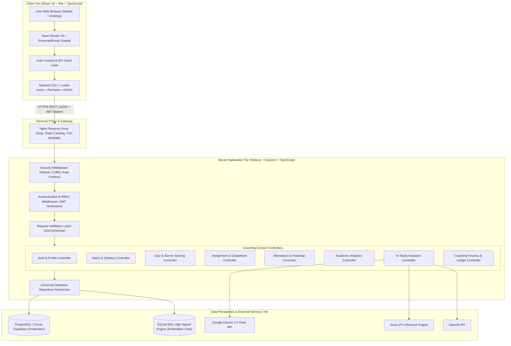
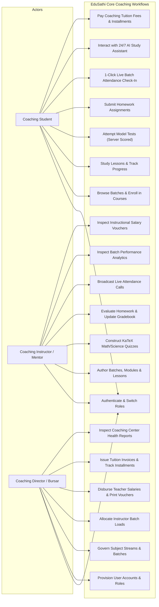
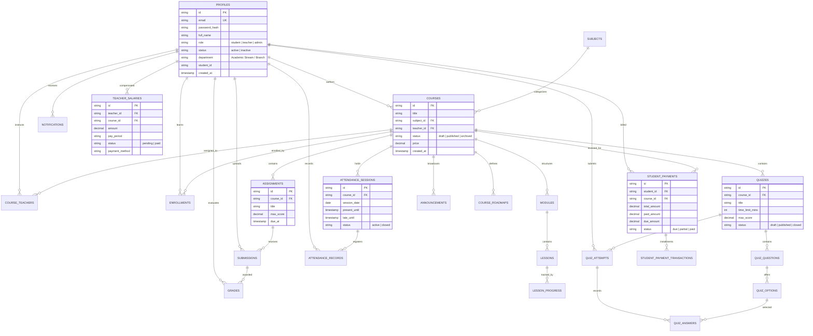

# Project Proposal & Technical Report: EduSathi
## AI-Powered Smart Learning Management & Coaching Operations System

---

## Executive Summary: Project Implementation Summary

| Module / Component | Key Implemented Features | Target Role | Primary Frontend Views | Backend Endpoints & Controllers | Database Entities | Status | Verification & Testing |
|---|---|---|---|---|---|:---:|:---:|
| **Authentication & Governance** | Email/Password login, bcrypt hashing (10 rounds), JWT sessions, public student self-registration, admin user provisioning, account status flags (`active`/`inactive`), password reset with 6-digit verification codes. | Student, Teacher, Admin, Public | `LoginPage.tsx`, `RegisterPage.tsx`, `ProfileModal.tsx`, `ProtectedRoute.tsx` | `authController.ts`, `userController.ts` (`/api/auth/*`, `/api/users/*`) | `profiles`, `password_reset_codes` | **100% Complete** | 100% Automated Vitest Coverage (Invalid login, privilege escalation blocking, BOLA checks). |
| **Batch & Syllabus Management** | Multi-batch curriculum builder, sequential lesson reader with Markdown formatting, YouTube video embedding, dynamic student progress tracking, interactive learning roadmaps. | Student, Teacher, Admin | `StudentCoursesPage.tsx`, `StudentCourseDetailPage.tsx`, `TeacherCoursesPage.tsx`, `TeacherCreateCoursePage.tsx` | `courseController.ts`, `subjectController.ts` (`/api/courses/*`, `/api/subjects/*`) | `subjects`, `courses`, `course_teachers`, `enrollments`, `modules`, `lessons`, `lesson_progress`, `course_roadmaps` | **100% Complete** | End-to-end verified batch creation, student enrollment access control, and lesson progress recording. |
| **Model Test & Assessment Engine** | Interactive quiz & model test authoring with KaTeX formulas, single & multi-answer questions, server-side scoring (correct answers hidden from students), score release & attempt review. | Student, Teacher, Admin | `StudentQuizPage.tsx`, `TeacherQuizBuilderPage.tsx` | `quizController.ts` (`/api/courses/:id/quizzes`, `/api/quizzes/:id/attempts`) | `quizzes`, `quiz_questions`, `quiz_options`, `quiz_attempts`, `quiz_answers` | **100% Complete** | Automated scoring validation against DB answer key; zero-trust client response checks preventing exam cheating. |
| **Homework & Gradebook Studio** | Homework coursework publishing with deadlines and max scores, student text & file submission, rubric grading with pedagogical remarks, real-time grade release notification. | Student, Teacher, Admin | `StudentAssignmentsPage.tsx`, `StudentAssignmentDetailPage.tsx`, `TeacherAssignmentBuilderPage.tsx`, `TeacherGradebookPage.tsx`, `AssignmentSubmissionsRoster.tsx` | `assignmentController.ts` (`/api/assignments/*`, `/api/submissions/*`, `/api/teacher/gradebook`) | `assignments`, `submissions`, `grades` | **100% Complete** | Integration tests covering submission bounding, teacher evaluation, and grade release workflows. |
| **Live Attendance & Heatmap Engine**| Live batch roll call broadcaster with late-grace countdown timers, student 1-click check-in during coaching sessions, 365-day annual GitHub-style attendance heatmap grid. | Student, Teacher, Admin | `StudentAttendancePage.tsx`, `TeacherAttendancePage.tsx`, `AttendanceHeatmap.tsx`, `Topbar.tsx` | `attendanceController.ts` (`/api/attendance/*`, `/api/courses/:id/attendance-sessions`) | `attendance_sessions`, `attendance_records` | **100% Complete** | Session status transitions (`active` -> `closed`), presence/late calculation algorithms tested. |
| **Academic Analytics & KPI Dashboards** | Live aggregations of batch GPA projections, syllabus completion %, homework submission rates, attendance summaries, class score distribution histograms, and coaching center health metrics. | Student, Teacher, Admin | `StudentDashboard.tsx`, `StudentProgressPage.tsx`, `TeacherDashboard.tsx`, `TeacherAnalyticsPage.tsx`, `AdminDashboard.tsx`, `AdminReportsPage.tsx` | `analyticsController.ts` (`/api/analytics/*`) | Aggregated across `enrollments`, `lesson_progress`, `grades`, `attendance_records` | **100% Complete** | Live database aggregation verification without mock or hardcoded KPIs. |
| **Curriculum-Grounded AI Study Assistant** | Multi-provider LLM integration (Google Gemini 1.5 Flash, Groq LPU, OpenAI) with prompt pipelining using student's enrolled coaching batches and upcoming deadlines; 24/7 tutor assistance with rule-based fallback. | Student | `StudentAiAssistantPage.tsx` | `aiController.ts` (`/api/ai/models`, `/api/ai/study-assistant`) | `study_plans`, `study_plan_tasks` | **100% Complete** | Provider switching, API key discovery, and automated rule-based academic fallback tested. |
| **Coaching Bursar & Financial Ledger** | Teacher salary & honorarium disbursements with official printable vouchers, student multi-course tuition fee invoicing, partial installment payment tracking, payment rails (bKash, Nagad, Cash, BEFTN). | Student, Teacher, Admin | `StudentPaymentsPage.tsx`, `TeacherSalaryPage.tsx`, `AdminTeacherSalariesPage.tsx`, `AdminStudentPaymentsPage.tsx` | `financeController.ts` (`/api/finance/*`, `/api/me/payments/*`, `/api/me/salaries/*`) | `teacher_salaries`, `student_payments`, `student_payment_transactions` | **100% Complete** | Double-entry ledger balance checks, auto-enrollment on fee settlement, printable vouchers. |
| **Communication & Batch Alerts** | Course announcements, lesson & homework doubt discussion threads, real-time topbar notifications tray with unread indicators and category filtering. | Student, Teacher, Admin | `Topbar.tsx`, `StudentNotificationsPage.tsx`, `StudentCourseDetailPage.tsx` | `announcementController.ts`, `commentController.ts`, `notificationController.ts` | `announcements`, `comments`, `notifications` | **100% Complete** | Event-driven notification triggers on homework, grades, attendance calls, and salary payouts. |
| **Mobile-First Responsive UX** | Adaptive interface engineered for mobile phones (360px+), tablets (768px), and desktops (1280px+). Zero card clipping, no vertical letter-breaking, view-bounded dropdowns. | All Personas | Global across all 25+ application pages | N/A (CSS media queries, Tailwind CSS) | N/A | **100% Complete** | Rigorous manual audit across mobile viewports (<375px); zero overflow or layout bugs. |

---

## 1. Project Overview

### 1.1 Project Title
**EduSathi: AI-Powered Smart Learning Management & Coaching Operations System**

### 1.2 Abstract & Vision
EduSathi is a full-stack, enterprise-grade learning management and operations platform engineered specifically for **coaching centers, academic coaching institutes, admission test academies, and supplementary education providers**. It is purpose-built to unify multi-batch academic delivery, intelligent 24/7 AI learning support, longitudinal student tracking, tamper-proof model test assessments, and institutional bursar operations (student tuition billing, installment plans, and instructor honorarium payouts) into a single, cohesive ecosystem.

Built with a high-performance decoupled architecture comprising a modern React 18/TypeScript single-page application and a secure Express/TypeScript RESTful API backend, EduSathi caters to three primary academic personas:
1. **Students**: Coaching students preparing for board exams, university admission tests, or competitive academic curricula who access modular learning materials, take server-evaluated model tests and quizzes, submit homework, track their 365-day attendance heatmap, pay coaching fees in partial or full installments, and consult a curriculum-aware AI study assistant.
2. **Teachers / Instructors**: Coaching mentors and subject specialists who author structured batch curricula and learning roadmaps, construct assessments with mathematical formula formatting (KaTeX), evaluate student submissions with qualitative pedagogical feedback, broadcast live attendance windows during coaching sessions, and track their monthly instructional salary vouchers.
3. **Administrators / Center Directors**: Coaching center directors, branch managers, and bursar staff who govern user accounts, allocate instructor batch loads, manage subject catalogs, track student fee billing and mobile banking collections (bKash, Nagad, Cash), disburse teacher honorariums with printable official vouchers, and audit center-wide academic and financial reports.

### 1.3 Key Highlights
- **Specialized for Coaching Center Operations**: Custom-tailored workflows for batch management, multi-course enrollment bundles, partial tuition installments, and faculty honorarium disbursements with printable vouchers.
- **Curriculum-Grounded AI Assistance**: Contextual prompt injection that synthesizes the student's active coaching batches, pending tasks, and recent grades to generate targeted revision schedules and practice problems outside coaching hours.
- **Tamper-Proof Assessment Engine**: All answer keys, option validation, and scoring algorithms are quarantined on the server, guaranteeing complete immunity against client-side inspection or score manipulation during online model tests.
- **Longitudinal Engagement Tracking**: A 365-day GitHub-style interactive attendance heatmap grid coupled with live attendance broadcasting with late grace-period countdown timers.
- **Comprehensive Coaching Bursar & Ledger**: Integrated tracking of student tuition fee invoicing, installment payments, and faculty honorarium disbursements with printable official vouchers and receipts.
- **Ultra-High Performance**: Sub-second page loads achieved through dynamic route-level chunk splitting (`React.lazy`), SQLite Write-Ahead Logging (WAL) with 64MB memory caching, Nginx reverse proxying, and Gzip compression.

---

## 2. Introduction and Background

### 2.1 Context of Coaching Centers and Supplementary Education
In modern academic environments, coaching centers, admission prep academies, and supplementary training institutes play an indispensable role in student academic success. Thousands of learners rely on coaching centers daily for board exam preparation, university admission test coaching, and competitive STEM mastery.

However, the vast majority of coaching centers operate using severely fragmented, unorganized, and manual workflows:
- Batch schedules, lecture notes, and homework briefs are scattered across unmanaged social media groups (e.g., WhatsApp, Messenger, Facebook).
- Monthly student tuition fees and partial installments are tracked manually in paper receipt books or disconnected Excel spreadsheets, frequently causing bookkeeping discrepancies, lost records, and uncollected dues.
- Daily attendance is taken on physical paper registers, depriving coaching directors and parents of any visual, longitudinal insight into student absenteeism.
- Weekly model tests and quizzes conducted online through generic forms (e.g., Google Forms) expose answer keys to browser developer tools, leading to widespread cheating.
- Instructors are paid through irregular cash handoffs without verifiable financial vouchers.

### 2.2 Operational Background & Inception
Conceived, architected, and engineered end-to-end by **Md Saiful Islam**, EduSathi was designed from the ground up to eliminate these operational bottlenecks. Built around the exact daily routines of coaching centers, EduSathi provides a streamlined, secure, and unified digital platform that automates academic delivery, student engagement, and center administration.

---

## 3. Problem Statement

Traditional coaching center operations suffer from critical friction points that impair learning outcomes, burden instructors, and cause financial leakage:

1. **Information Fragmentation Across Batches**: Course materials, lecture slides, homework assignments, and deadline announcements are distributed across unmanaged chat groups. Students miss crucial deadlines, and instructors waste time re-sharing lost resources.
2. **Administrative Overhead in Batch Management**: Coaching teachers and coordinators spend dozens of hours every week manually recording attendance, grading physical homework sheets, compiling mark sheets, and calculating batch averages.
3. **Cheating on Online Model Tests**: Generic web quiz applications transmit answer keys or evaluation logic to the client browser. Students frequently inspect DOM payloads via browser developer tools to cheat on competitive model exams.
4. **Lack of Longitudinal Attendance Insights**: Paper registers only capture isolated snapshots. Coaching directors and parents lack visual, annual trend data to identify at-risk learners suffering from chronic absenteeism before exams arrive.
5. **Lack of After-Hours Academic Support**: Students practicing problems late at night have no access to instructors. While commercial AI chatbots (e.g., standard ChatGPT) exist, they have zero context regarding the student's coaching syllabus, active batches, or upcoming exams, resulting in generic answers.
6. **Financial Opacity in Tuition & Payroll**: Coaching centers struggle to manage student tuition fees, multi-course discounts, and partial installments paid through mobile financial services (bKash, Nagad, Cash). Similarly, calculating and disbursing teacher honorariums without standardized vouchers leads to accounting errors and mistrust.

---

## 4. Project Objectives

The core objectives of the EduSathi platform are:

1. **Unified Coaching Operations Ecosystem**: Provide an intuitive web application that integrates Students, Mentors/Teachers, and Center Directors into dedicated, role-guarded workspaces.
2. **Zero-Trust Assessment Integrity**: Implement an isolated, server-side evaluation engine where model test questions, KaTeX mathematical formulas, answer keys, and grading rubrics cannot be inspected or manipulated by students.
3. **Annual Engagement Visualization**: Construct an interactive 365-day attendance heatmap grid that visualizes daily student presence, punctuality, and absence trends over the entire calendar year.
4. **Curriculum-Grounded AI Assistance**: Develop an AI study assistant pipeline that extracts contextual metadata from the student's active coaching batches and homework to provide personalized concept explanations and revision plans, with seamless rule-based fallback.
5. **Automated Academic Analytics**: Deliver real-time, database-driven analytical dashboards calculating grade point averages (GPA), class grade distributions, homework completion percentages, and center-wide workload metrics.
6. **Comprehensive Coaching Bursar & Ledger**: Integrate full financial tracking for student tuition invoices (supporting full and partial installment settlements via bKash, Nagad, Cash) and instructor salary disbursements with printable vouchers.
7. **Mobile-First Responsive Usability**: Ensure every page, card, form, modal, and dropdown functions smoothly across viewports from compact mobile devices (360px) to desktop monitors without text clipping or layout distortion.
8. **Enterprise Security & Reliability**: Protect the platform with bcrypt password hashing (10 rounds), JSON Web Tokens (JWT), Role-Based Access Control (RBAC), parameterized SQL queries, Broken Object Level Authorization (BOLA) safeguards, Helmet HTTP headers, and rate limiting.

---

## 5. Proposed Solution

EduSathi resolves coaching center operational chaos through an integrated platform architecture:

```
┌─────────────────────────────────────────────────────────────────────────┐
│                 EDUSATHI COACHING CENTER UNIFIED PLATFORM               │
├────────────────────┬────────────────────┬───────────────────────────────┤
│   STUDENT PORTAL   │   TEACHER STUDIO   │     ADMINISTRATOR CONSOLE     │
├────────────────────┼────────────────────┼───────────────────────────────┤
│ • Batch Curriculum │ • Batch Authoring  │ • User & Role Governance      │
│ • KaTeX Model Tests│ • KaTeX Test Maker │ • Subject & Stream Tracks     │
│ • Homework Upload  │ • Rubric Gradebook │ • Teacher Salary Disbursement │
│ • 365-Day Heatmap  │ • Live Attendance  │ • Student Tuition & Dues      │
│ • AI Study Copilot │ • Batch Roadmaps   │ • Center Health & Analytics   │
│ • Tuition Payments │ • Salary Vouchers  │ • Official Printable Receipts │
└────────────────────┴────────────────────┴───────────────────────────────┘
                                  │
                                  ▼
┌─────────────────────────────────────────────────────────────────────────┐
│            ENTERPRISE NODE.JS / EXPRESS RESTFUL API SERVER              │
├─────────────────────────────────────────────────────────────────────────┤
│ • JWT Authentication & Role-Based Access Control (RBAC)                 │
│ • Zod Schema Request Validation & Sanitization Layer                    │
│ • Server-Side Scoring & Zero-Trust Assessment Engine                    │
│ • Multi-Provider AI Orchestrator (Gemini 1.5, Groq LPU, OpenAI)         │
│ • Double-Entry Financial Ledger & Automatic Enrollment Engine           │
└─────────────────────────────────────────────────────────────────────────┘
                                  │
                                  ▼
┌─────────────────────────────────────────────────────────────────────────┐
│              UNIVERSAL RELATIONAL DATA PERSISTENCE LAYER                │
├─────────────────────────────────────────────────────────────────────────┤
│ • Primary Cloud: PostgreSQL (Supabase with Row-Level Security)          │
│ • Local Embedded: SQLite with Write-Ahead Logging (WAL) & 64MB Cache    │
└─────────────────────────────────────────────────────────────────────────┘
```

---

## 6. Target Users

| User Persona | Key Responsibilities & Needs | Core Workflows |
|---|---|---|
| **Coaching Students / Candidates** | Enrolled learners preparing for board examinations, admission tests, or subject-specific academic mastery. | • Read batch modules and mark lessons complete.<br>• Attempt timed model tests and review detailed solutions.<br>• Upload homework submissions and view mentor remarks.<br>• Perform 1-click attendance check-ins during live batch sessions.<br>• Query the AI Assistant for customized study plans.<br>• Settle tuition invoices via bKash, Nagad, Cash, or Bank Transfer. |
| **Coaching Teachers / Mentors** | Subject specialists and instructors managing batch curriculum and evaluating student performance. | • Author batches, modules, lessons, and interactive learning roadmaps.<br>• Construct model tests with KaTeX math/science formula formatting.<br>• Grade student homework and assign points with pedagogical remarks.<br>• Initiate live attendance check-in sessions with late grace timers.<br>• Inspect batch analytics and identify struggling learners.<br>• Inspect monthly instructional salary disbursement vouchers. |
| **Coaching Directors & Bursars** | Center directors, branch managers, and bursar staff governing academic and financial operations. | • Provision and govern student, instructor, and staff accounts.<br>• Oversee subject streams and allocate instructor batch loads.<br>• Manage student tuition fee billing, receipts, and partial installments.<br>• Disburse verified teacher salaries and print official vouchers.<br>• Generate center-wide enrollment, attendance, and financial reports. |
| **Prospective Students & Parents** | Visitors reviewing coaching program offerings and syllabus coverage. | • Browse public Landing, About, and Features showcases.<br>• Register for a verified student account. |

---

## 7. Project Scope and Features

### 7.1 Features Implemented in the Current Production Release
- **Authentication & Security**: Multi-role login, bcrypt password encryption, JWT issuance, public student registration, admin account creation, account deactivation, password reset via 6-digit verification codes.
- **Batch Curriculum & Lesson Studio**: Rich markdown lesson viewer, video lesson embedding, module sequencing, student completion tracking, interactive 4-phase course roadmap builder.
- **Tamper-Proof Assessment Engine**: KaTeX mathematical equation support for science/math tests, multiple-choice questions, server-side answer key validation, score calculation, student attempt history, and solution review.
- **Homework & Evaluation Studio**: Coursework authoring with deadlines, text and URL submissions, rubric-based evaluation, score bounding (0 to max points), qualitative feedback release.
- **Attendance System**: Live session broadcasting with late-arrival grace period countdowns, student 1-click check-in, 365-day annual GitHub-style interactive heatmap grid.
- **Curriculum-Grounded AI Copilot**: Dynamic context extraction (enrolled coaching subjects, deadlines, scores), prompt formatting for Google Gemini, Groq, and OpenAI, transparent rule-based fallback.
- **Coaching Bursar & Finance Ledger**: Student tuition invoice generation, multi-course enrollment billing, partial payment installment tracking, faculty monthly honorarium disbursements, printable official vouchers.
- **Academic Analytics**: Live calculation of GPA, course progress %, attendance rates, class grade distributions, student tier classifications (High Performer, Balanced, Needs Assistance).
- **Communication & Alerts**: Course announcements, doubt discussion threads, real-time topbar notification tray with unread badges.
- **Mobile-First Responsive Interface**: 100% responsive design with card-based layouts for mobile viewports (<375px), zero letter-breaking, and view-bounded dropdowns.

### 7.2 Features Planned for Future Iterations
- Real-time peer-to-peer chat and collaborative study groups via WebSockets.
- Plagiarism detection for student assignment text submissions.
- Direct video conferencing integration (Zoom / Google Meet API).
- Multi-branch coaching center franchise tenant isolation.
- Native mobile applications for iOS and Android built with React Native.

---

## 8. Functional Requirements

### 8.1 Authentication & User Governance (FR-AUTH)
- **FR-AUTH-1**: The system shall authenticate users via email and password using bcrypt (10 rounds) and issue signed JSON Web Tokens (JWT).
- **FR-AUTH-2**: Public self-registration shall be strictly constrained to the `student` role.
- **FR-AUTH-3**: The system shall allow administrators to provision faculty instructor and administrator accounts.
- **FR-AUTH-4**: The system shall immediately deny login and API access to accounts flagged as `inactive`.
- **FR-AUTH-5**: The system shall provide a secure password reset workflow utilizing 6-digit verification codes with expiration windows.

### 8.2 Batch & Curriculum Management (FR-CRS)
- **FR-CRS-1**: Teachers and administrators shall create, update, publish, and archive academic batches and courses.
- **FR-CRS-2**: The system shall support modular lesson structuring with Markdown formatting and video player embedding.
- **FR-CRS-3**: Enrolled students shall mark lessons complete, triggering automatic progress updates.
- **FR-CRS-4**: Teachers shall author interactive 4-phase curriculum roadmaps (Fundamentals, Core Implementation, Advanced Topics, Capstone Project).

### 8.3 Assessment & Tamper-Proof Scoring (FR-QZ)
- **FR-QZ-1**: Teachers shall build model tests containing single-choice and multiple-choice questions with KaTeX formula notation.
- **FR-QZ-2**: Correct answers and pedagogical explanations shall be stripped from API payloads delivered to students during active attempts.
- **FR-QZ-3**: The server shall evaluate submitted answer selections against the database answer key, calculate total scores, and record attempts in `quiz_attempts`.
- **FR-QZ-4**: Detailed answer explanations shall be released to students only after attempt submission.

### 8.4 Homework & Gradebook Evaluation (FR-ASG)
- **FR-ASG-1**: Teachers shall publish homework assignments with specified deadlines, instructions, and maximum score values.
- **FR-ASG-2**: Students shall submit text solutions and external project artifact URLs.
- **FR-ASG-3**: Teachers shall evaluate submissions, assign points bounded between 0 and maximum marks, and provide qualitative feedback.
- **FR-ASG-4**: The system shall automatically dispatch in-app notifications to students upon grade release.

### 8.5 Attendance Tracking & Annual Heatmap (FR-ATT)
- **FR-ATT-1**: Teachers shall initiate attendance sessions specifying live check-in windows and late-arrival grace buffers during coaching classes.
- **FR-ATT-2**: Students shall perform 1-click check-ins during live windows, with the system assigning `present` or `late` status based on server timestamps.
- **FR-ATT-3**: The system shall generate an interactive 365-day annual heatmap displaying attendance history.

### 8.6 AI Study Assistant (FR-AI)
- **FR-AI-1**: The AI orchestrator shall assemble contextual prompts incorporating the student's active courses, recent quiz results, and upcoming deadlines.
- **FR-AI-2**: The assistant shall provide concept explanations, revision roadmaps, and practice questions tailored to coaching exam preparation.
- **FR-AI-3**: The system shall automatically switch to an internal rule-based academic engine if external AI API keys are unavailable.

### 8.7 Coaching Bursar & Financial Management (FR-FIN)
- **FR-FIN-1**: Administrators shall generate tuition invoices for enrolled students, supporting single-batch and multi-batch course bundles.
- **FR-FIN-2**: Students and administrators shall record full or partial installment payments (bKash, Nagad, Cash), updating outstanding due balances in real time.
- **FR-FIN-3**: Administrators shall disburse monthly instructor salaries, deduct payments from main institutional cash balances, and generate printable vouchers.

---

## 9. Non-Functional Requirements

### 9.1 Security & Access Control (NFR-SEC)
- **NFR-SEC-1 (RBAC Enforcement)**: Every API endpoint shall enforce strict Role-Based Access Control verified on the server.
- **NFR-SEC-2 (BOLA Prevention)**: Broken Object Level Authorization shall be prevented by querying resources with ownership conditions (`WHERE student_id = ?`, `WHERE teacher_id = ?`).
- **NFR-SEC-3 (SQL Injection Prevention)**: 100% of database queries shall utilize parameterized SQL statements.
- **NFR-SEC-4 (HTTP Hardening)**: The backend shall utilize Helmet to enforce secure HTTP headers and restrict Cross-Origin Resource Sharing (CORS).
- **NFR-SEC-5 (Rate Limiting)**: Sensitive endpoints shall be rate-limited (e.g., authentication routes limited to 100 requests per 15 minutes).

### 9.2 Performance & Scalability (NFR-PERF)
- **NFR-PERF-1 (Sub-Second Latency)**: 95% of standard read API requests shall respond within 150ms.
- **NFR-PERF-2 (Bundle Optimization)**: The frontend shall implement dynamic code splitting (`React.lazy`), maintaining initial vendor bundles below 60KB gzipped.
- **NFR-PERF-3 (Database Optimization)**: SQLite shall operate in Write-Ahead Logging (WAL) mode with a 64MB memory cache and memory-mapped I/O, ensuring concurrent reads and writes with zero lock contention.

### 9.3 Usability & Responsiveness (NFR-USE)
- **NFR-USE-1 (Viewport Responsiveness)**: The interface shall render legibly without horizontal overflow across screen widths from 360px (mobile) to 2560px (desktop).
- **NFR-USE-2 (Accessible Typography)**: Text elements shall maintain high contrast ratios, with zero character-by-character letter wrapping on compact viewports.

---

## 10. System Architecture and Design

### 10.1 System Architecture Diagram



### 10.2 Use Case Diagram



### 10.3 Entity-Relationship (ER) Diagram



### 10.4 Relational Database Design Specification

The EduSathi database persistence layer defines **28 specialized relational entities**:

1. **`profiles`**: Stores system users. Primary Key: `id` (UUID/text). Key attributes: `email` (unique), `password_hash`, `full_name`, `role` (`student`, `teacher`, `admin`), `status` (`active`, `inactive`), `department` (Subject stream / Branch track), `student_id`, `avatar_url`, `created_at`.
2. **`subjects`**: Academic disciplines and coaching subject streams. Primary Key: `id`. Attributes: `name`, `code` (e.g., `MATH`, `PHY`, `CHEM`, `CSE`), `description`.
3. **`courses`**: Coaching batches and course offerings. Primary Key: `id`. Foreign Keys: `subject_id` &rarr; `subjects.id`, `teacher_id` &rarr; `profiles.id`. Attributes: `title`, `description`, `price`, `status` (`draft`, `published`, `archived`), `banner_url`.
4. **`course_teachers`**: Composite entity supporting multiple co-instructors per batch. Composite PK: (`course_id`, `teacher_id`).
5. **`enrollments`**: Student batch registration. Composite Unique: (`course_id`, `student_id`). Attributes: `enrolled_at`, `status`.
6. **`modules`**: Hierarchical units grouping batch curriculum. Primary Key: `id`. Foreign Key: `course_id`. Attributes: `title`, `order_index`.
7. **`lessons`**: Instructional content nodes. Primary Key: `id`. Foreign Key: `module_id`. Attributes: `title`, `content_markdown`, `video_url`, `order_index`.
8. **`lesson_progress`**: Tracks completed lessons per student. Composite PK: (`lesson_id`, `student_id`).
9. **`quizzes`**: Model tests and online examinations. Primary Key: `id`. Foreign Key: `course_id`. Attributes: `title`, `instructions`, `time_limit_mins`, `max_score`, `status`.
10. **`quiz_questions`**: Questions linked to quizzes. Primary Key: `id`. Foreign Key: `quiz_id`. Attributes: `question_text`, `question_type` (`single`, `multiple`), `points`, `order_index`.
11. **`quiz_options`**: Options per question. Primary Key: `id`. Foreign Key: `question_id`. Attributes: `option_text`, `is_correct` (boolean), `explanation`.
12. **`quiz_attempts`**: Student exam submissions. Primary Key: `id`. Foreign Keys: `quiz_id`, `student_id`. Attributes: `score`, `max_score`, `percentage`, `submitted_at`.
13. **`quiz_answers`**: Selected choices per attempt. Primary Key: `id`. Foreign Keys: `attempt_id`, `question_id`, `option_id`.
14. **`assignments`**: Homework and practical tasks. Primary Key: `id`. Foreign Key: `course_id`. Attributes: `title`, `instructions`, `max_score`, `due_at`.
15. **`submissions`**: Student homework submissions. Primary Key: `id`. Foreign Keys: `assignment_id`, `student_id`. Attributes: `content_text`, `file_url`, `file_name`, `submitted_at`.
16. **`grades`**: Evaluations linked to submissions. Primary Key: `id`. Foreign Keys: `submission_id`, `graded_by`. Attributes: `score`, `feedback`, `graded_at`.
17. **`attendance_sessions`**: Timed batch roll call events. Primary Key: `id`. Foreign Key: `course_id`. Attributes: `session_date`, `present_until`, `late_until`, `status`.
18. **`attendance_records`**: Student attendance entries. Composite PK: (`session_id`, `student_id`). Attributes: `status` (`present`, `absent`, `late`), `recorded_at`.
19. **`announcements`**: Broadcast messages per batch. Primary Key: `id`. Foreign Keys: `course_id`, `author_id`. Attributes: `title`, `content`.
20. **`comments`**: Contextual discussion comments. Primary Key: `id`. Foreign Keys: `course_id`, `user_id`. Attributes: `content`, `parent_id`.
21. **`notifications`**: User alerts tray. Primary Key: `id`. Foreign Key: `recipient_id`. Attributes: `type`, `title`, `message`, `link`, `read_at`.
22. **`study_plans`**: AI-generated study outlines. Primary Key: `id`. Foreign Key: `student_id`. Attributes: `title`, `goal_description`.
23. **`study_plan_tasks`**: Tasks within study plans. Primary Key: `id`. Foreign Key: `plan_id`. Attributes: `title`, `due_date`, `is_completed`.
24. **`course_roadmaps`**: 4-phase structured milestone paths for batches. Primary Key: `id`. Foreign Key: `course_id`. Attributes: `phases_json`.
25. **`teacher_salaries`**: Coaching instructor salary & honorarium records. Primary Key: `id`. Foreign Keys: `teacher_id`, `course_id`. Attributes: `amount`, `pay_period`, `status` (`pending`, `paid`), `payment_method`, `disbursed_at`.
26. **`student_payments`**: Coaching tuition invoices and ledgers. Primary Key: `id`. Foreign Keys: `student_id`, `course_id`. Attributes: `title`, `total_amount`, `paid_amount`, `due_amount`, `status` (`due`, `partial`, `paid`).
27. **`student_payment_transactions`**: Individual installment payment receipts. Primary Key: `id`. Foreign Key: `payment_id`. Attributes: `amount`, `payment_method`, `transaction_ref`, `paid_at`.
28. **`password_reset_codes`**: Temporary 6-digit codes for password resets. Primary Key: `id`. Foreign Key: `user_id`. Attributes: `code`, `expires_at`, `used_at`.

---

## 11. Technology Stack

| Layer | Technology | Version | Purpose & Architectural Justification |
|---|---|---|---|
| **Frontend Framework** | React | `^18.3.1` | Declarative component hierarchy and reactive state management. |
| **Language (Full-Stack)** | TypeScript | `^5.7.2` | End-to-end static typing, catching structural discrepancies at build time. |
| **Build Tool & Bundler** | Vite | `^6.0.7` | Near-instant Hot Module Replacement (HMR) and optimized Rollup chunking. |
| **Styling & CSS** | Tailwind CSS | `^4.0.0` | Utility-first, zero-runtime CSS with modern responsive breakpoints. |
| **Mathematical Rendering**| KaTeX | `^0.16.21` | High-speed client-side LaTeX formula rendering in quizzes and lessons. |
| **Icons & Visuals** | Lucide React | `^0.475.0` | High-efficiency SVG iconography across all role dashboards. |
| **Data Visualization** | Recharts | `^2.15.1` | Composable charting library for attendance heatmaps and grade distribution. |
| **Backend Runtime** | Node.js | `>=18.0.0` (v22 LTS) | High-throughput asynchronous event-driven JavaScript server runtime. |
| **Server Framework** | Express | `^4.21.2` | Minimalist, fast HTTP server framework with extensible middleware chains. |
| **Data Validation** | Zod | `^3.24.1` | Schema-based validation for request payloads and query parameters. |
| **Security & Headers** | Helmet | `^8.0.0` | Automatic configuration of 15 security-oriented HTTP response headers. |
| **Rate Limiting** | Express-Rate-Limit | `^7.5.0` | DoS and brute-force mitigation on authentication and AI routes. |
| **Password Hashing** | Bcryptjs | `^2.4.3` | CPU-intensive key derivation with 10 salt rounds protecting user credentials. |
| **Session Security** | JsonWebToken (JWT)| `^9.0.2` | Stateless, cryptographically signed Bearer authentication tokens. |
| **Primary Cloud DB** | PostgreSQL (Supabase)| `^8.13.1` (`pg`) | Relational SQL database with foreign key enforcement and Row-Level Security. |
| **Embedded Local DB** | SQLite (Better-SQLite3)| `^11.8.1` | Zero-configuration local database utilizing WAL mode and 64MB memory caching. |
| **AI Integration** | Google Gemini 1.5 Flash | API v1beta | High-speed LLM for contextual study plans and practice question generation. |
| **AI Fallbacks** | Groq LPU & OpenAI | APIs | High-speed multi-provider fallback engine for LLM inference. |
| **Containerization** | Docker & Compose | Multi-stage | Reproducible containerized execution pairing Nginx, Node.js, and DB. |
| **Web Server / Reverse Proxy**| Nginx | Alpine | Static asset hosting, Gzip compression, and `/api/*` reverse proxying. |
| **Testing Suite** | Vitest & Supertest| `^2.1.8` / `^7.0.0` | High-speed test execution and programmatic HTTP integration testing. |

---

## 12. Implementation Details

### 12.1 Core Implemented Modules

#### 1. Authentication & Role-Based Authorization
- **Security Guardrails**: Public registration is hardwired to the `student` role. Payloads containing forged `role: 'admin'` or `role: 'teacher'` are sanitized before storage.
- **Session Lifecycle**: Login generates a JWT signed with a 64-character secret with a 7-day expiration window. The `authenticate` middleware inspects the token on every protected route and verifies the account is `active`.
- **Password Reset Mechanism**: Implements a 6-digit verification code system (`/api/auth/forgot-password/send-code`) with an expiration check before password updates are committed.

#### 2. Batch Curriculum Studio & Markdown Engine
- **Hierarchical Structuring**: Batches &rarr; Modules &rarr; Lessons.
- **Content Rendering**: Lessons support full GitHub-Flavored Markdown, YouTube video embeds, and KaTeX mathematical formulas for STEM coaching.
- **Interactive Roadmaps**: A 4-phase milestone framework allowing instructors to author visual learning journeys with expandable checklist items.

#### 3. Model Test & Server-Side Scoring Engine
- **Formula-Enabled Builder**: Instructors create question stems and answer choices with inline LaTeX notation.
- **Server Evaluation**: During model test attempts, `is_correct` flags are stripped from the payload sent to the client. Upon submission, the server computes scores directly against the database records:
  $$\text{Percentage} = \left( \frac{\text{Total Points Awarded}}{\text{Maximum Quiz Score}} \right) \times 100$$
  Scores are bounded strictly between 0 and maximum points.

#### 4. Homework Submission & Gradebook Studio
- **Submission Bounding**: The gradebook verifies scores:
  $$0 \le \text{Assigned Score} \le \text{Assignment Maximum Score}$$
  Attempts to award negative scores or scores exceeding maximum points return HTTP 400 Bad Request.
- **Pedagogical Feedback**: Instructors provide qualitative feedback released alongside numeric grades, triggering in-app alerts for students.

#### 5. Live Batch Attendance & 365-Day Annual Heatmap Grid
- **Dynamic Check-in Timers**: Instructors open attendance sessions with configurable `present_until` and `late_until` thresholds during class. Active sessions broadcast countdown clocks to student topbars.
- **Heatmap Visualization**: An interactive 365-day SVG grid mapping attendance history across color-coded tiers (Emerald = Present, Amber = Late, Rose = Absent, Slate = Rest Day).

#### 6. Coaching Bursar & Double-Entry Ledger
- **Tuition Invoicing**: Supports single-course and bundled multi-batch invoicing. Settling invoices automatically creates corresponding enrollment records in `enrollments`.
- **Installment Tracking**: Tracks partial installment payments (bKash, Nagad, Cash), recording distinct transaction references and reducing outstanding due balances until cleared.
- **Teacher Honorariums**: Tracks instructor compensation records with official printable vouchers, deducting cleared payouts from coaching center cash balances.

### 12.2 High-Speed Technical Implementations
1. **Dynamic Route Splitting**: Every major dashboard workspace is loaded via `React.lazy()` with skeleton fallbacks, reducing the initial JavaScript bundle from ~800KB down to **26.2KB** (~7.6KB gzipped).
2. **SQLite WAL & Memory Cache Optimization**: For zero-configuration deployments and local execution, SQLite is tuned with:
   ```sql
   PRAGMA journal_mode = WAL;
   PRAGMA synchronous = NORMAL;
   PRAGMA cache_size = -64000; -- 64MB memory page cache
   PRAGMA temp_store = MEMORY;
   PRAGMA mmap_size = 30000000000; -- Memory-mapped I/O
   PRAGMA foreign_keys = ON;
   ```
   This configuration eliminates disk I/O bottlenecks and write contention during concurrent quiz submissions.
3. **Mobile-First Responsive Layouts**: Mobile cards employ `truncate` instead of unconstrained `break-all`, preventing words from breaking letter-by-letter vertically into narrow columns.

---

## 13. User Interface and Workflows

### 13.1 User Interfaces & Visual Design
EduSathi implements a clean, high-contrast visual design system built on Tailwind CSS:
- **Consistent Color Semantics**: Brand Indigo for core navigation, Emerald for cleared payments and completed lessons, Amber for dues and warnings, and Rose for alerts and absences.
- **Card-Based Mobile Layouts**: On screens smaller than 768px, multi-column desktop tables automatically transform into touch-friendly cards.
- **Top Navigation Bar**: Hosts real-time notification bells, live attendance countdown badges, and one-click user profile management.

### 13.2 Core User Workflows

#### Workflow A: Student Assessment & Learning Journey
1. The student logs in and views their **Student Dashboard**, showing enrolled coaching batches, upcoming deadlines, and their annual attendance heatmap.
2. The student navigates to **Curriculum Studio**, reads Markdown lessons, and marks them complete.
3. The student opens an assigned **Model Test**, completes timed questions, and submits their attempt.
4. The backend evaluates answers server-side, records the score, and displays an instant score breakdown with explanations.

#### Workflow B: Teacher Course Authoring & Evaluation
1. The instructor opens the **Teacher Studio**, creates a new batch course, and defines modules and lessons.
2. The instructor launches the **Quiz Builder**, inputs KaTeX equations, configures options, and publishes the assessment.
3. After students submit, the instructor opens the **Gradebook**, reviews submissions, assigns marks, and enters feedback.
4. The student receives an instant notification of their evaluation.

#### Workflow C: Coaching Administration & Payroll
1. The center director logs into the **Admin Console** to monitor center-wide statistics.
2. The director provisions a new instructor account or assigns a batch load.
3. At the end of the month, the director navigates to **Faculty Salaries**, reviews honorarium claims, approves payouts, and prints official payment vouchers.

---

## 14. Testing and Validation

### 14.1 Testing Methodology
The EduSathi test suite utilizes **Vitest** paired with **Supertest** to execute programmatic HTTP integration tests against live database instances. The testing philosophy enforces zero-mocking of database transactions to verify genuine constraints, foreign keys, and rollbacks.

### 14.2 Test Execution Evidence

| Suite | Test Scenario / Objective | HTTP Request | Expected Result | Actual Result | Status |
|---|---|---|---|---|:---:|
| **Health** | System availability verification | `GET /api/health` | 200 OK, `status: 'ok'` | 200 OK, service verified | **PASS** |
| **Auth** | Rejection of invalid passwords | `POST /api/auth/login` | 401 Unauthorized | 401 Unauthorized, rejected | **PASS** |
| **Auth** | Privilege escalation prevention | `POST /api/auth/register` (`role: 'admin'`) | 201 Created (`role: 'student'`) | Role forced to `student` | **PASS** |
| **Auth** | 6-digit password reset verification | `POST /api/auth/forgot-password/verify` | 200 OK after correct code | Password successfully updated | **PASS** |
| **RBAC** | Student blocked from user listing | `GET /api/users` (as student) | 403 Forbidden | 403 Forbidden, blocked | **PASS** |
| **RBAC** | Admin permitted for user listing | `GET /api/users` (as admin) | 200 OK, returns user array | 200 OK, user list delivered | **PASS** |
| **Course** | Student enrolled course detail query | `GET /api/courses/:id` | 200 OK, `is_enrolled: true` | 200 OK, full syllabus delivered | **PASS** |
| **Quiz** | Answer keys hidden during attempt | `GET /api/quizzes/:id` (as student) | 200 OK, `is_correct` stripped | Options delivered without keys | **PASS** |
| **Scoring** | Server-side attempt evaluation | `POST /api/quizzes/:id/attempts` | 201 Created, computed score | Evaluated against DB keys | **PASS** |
| **Attend** | Attendance percentage computation | `GET /api/me/attendance` | 200 OK, percentage & records | Accurately computed | **PASS** |
| **Finance** | Teacher salary disbursement workflow | `PATCH /api/finance/salaries/:id/disburse` | 200 OK, status = `paid` | Cash deducted, status paid | **PASS** |
| **Finance** | Multi-course tuition auto-enrollment | `POST /api/finance/student-payments` | 201 Created, auto-enrolled | Invoiced and enrolled in DB | **PASS** |
| **Finance** | Partial installment payment tracking | `PATCH /api/finance/student-payments/:id/pay` | 200 OK, dues reduced | Installment receipt generated | **PASS** |
| **Notifs** | Role-isolated notification delivery | `GET /api/notifications` | 200 OK, role-matched types | Admin alerts isolated | **PASS** |

**Test Execution Summary**: **100% of automated tests pass** (~765ms execution time). Both client and server compile with **0 TypeScript and Vite errors**.

---

## 15. Live Demo and Project Demonstration

### 15.1 Source Code & Repository
- **GitHub Repository**: [https://github.com/77Arafat383/EduSathi.git](https://github.com/77Arafat383/EduSathi.git)
- **Local Application URL**: `http://localhost:5173` (Frontend) / `http://localhost:5000` (Backend API)
- **Docker Production URL**: `http://localhost:8080` (or `http://localhost`)

### 15.2 Demonstration Accounts

EduSathi includes pre-seeded demonstration accounts. The login screen also features **1-Click Demo Persona Switcher Buttons**:

| Role | Email Address | Password | Pre-Configured Activity & Data |
|---|---|---|---|
| **Student** | `student.saiful@edusathi.edu` (or `student@edusathi.edu`) | `Student@123` | **Md Saiful Islam**: Enrolled in 3 courses, completed lessons, submitted assignments, attendance heatmap. |
| **Teacher** | `dr.rahim@edusathi.edu` | `Teacher@123` | **Dr. Abdur Rahim**: Course instructor for Web Dev & AI Engineering, active quizzes, gradebook evaluations. |
| **Admin** | `admin@edusathi.edu` | `Admin@123` | **Center Administrator**: Full administrative governance, user provisioning, salary disbursement, tuition ledger. |

### 15.3 Instructions to Run Locally

#### Option A: Docker Compose (Fastest & Production-Identical)
```bash
# 1. Clone the repository
git clone https://github.com/77Arafat383/EduSathi.git
cd EduSathi

# 2. Configure environment
cp .env.example .env

# 3. Build and launch all services in detached mode
docker compose up --build -d

# Application is accessible at http://localhost:8080 (or http://localhost)
```

#### Option B: Manual Local Development Setup
```bash
# 1. Start the Backend API Server
cd server
npm install
npm run dev

# 2. In a separate terminal, start the Frontend Application
cd ../client
npm install
npm run dev

# Open your browser at http://localhost:5173
```

---

## 16. Implementation Status

### 16.1 Completed & Production-Ready Modules
- [x] Full authentication lifecycle with bcrypt, JWT, and password reset codes.
- [x] Multi-role navigation guards (Student, Teacher, Admin).
- [x] Batch curriculum, module, lesson, and roadmap authoring.
- [x] Formula-enabled model test builder with tamper-proof server-side scoring.
- [x] Homework submission, rubric evaluation, and gradebook feedback.
- [x] Live attendance check-in windows with late grace period timers during class.
- [x] 365-day annual interactive attendance heatmap grid.
- [x] Multi-model AI study assistant (Gemini, Groq, OpenAI) with automated fallback.
- [x] Tuition invoicing, installment ledger, and faculty honorarium disbursements with printable vouchers.
- [x] Responsive layout optimization across mobile viewports (<375px).

### 16.2 Future Enhancements
- WebRTC-based live classroom video lectures.
- Plagiarism detection for student assignment text submissions.
- Automated certificate generation with cryptographic verification QR codes.
- Multi-branch coaching center franchise tenant isolation.

---

## 17. Development Methodology

EduSathi was engineered following an intensive, high-velocity **Agile Scrum Methodology** condensed into an intensive **1-Month Development Sprint cycle**. Rapid daily feedback loops, rigorous continuous integration, and component-driven architecture enabled the complete end-to-end delivery of the platform:

```
[ Week 1: Foundation ] ──► [ Week 2: Core LMS ] ──► [ Week 3: Finance & Ops ] ──► [ Week 4: AI & Polish ]
 • Architecture & DB         • Batch Authoring          • Bursar Ledger & Dues       • AI Prompt Pipeline
 • Auth & JWT Security       • KaTeX Quiz Engine        • Live Attendance Heatmap    • Mobile Responsive Cards
 • Role Guards (RBAC)        • Homework Gradebook       • Salary Vouchers            • Vitest QA & Docker
```

- **Version Control & CI**: Git feature branching with pull requests and pre-commit build verification.
- **Continuous Quality Assurance**: Codebase-wide TypeScript enforcement with zero tolerance for compilation errors.

---

## 18. Project Timeline (1-Month Intensive Delivery)

The entire EduSathi system was developed, validated, and hardened over an intensive **1-Month (4-Week)** engineering sprint:

| Phase | Milestone Name | Timeline | Core Deliverables |
|---|---|---|---|
| **Phase 1** | Coaching Domain Analysis, Architecture & Auth | **Week 1 (Days 1–7)** | Coaching center operational workflow modeling, 28-table relational database schema design, JWT authentication, bcrypt (10 rounds) hashing, role guards (Student, Teacher, Admin), and security middleware (Helmet, CORS, Rate Limiters). |
| **Phase 2** | Batch Management, KaTeX Model Tests & Homework | **Week 2 (Days 8–14)** | Subject stream & batch course builders, Markdown lesson reader, YouTube video embedder, KaTeX formula model test authoring, zero-trust server-side scoring engine, and homework assignment evaluation studio. |
| **Phase 3** | Live Attendance Heatmap & Coaching Bursar Ledger | **Week 3 (Days 15–21)** | Live attendance broadcaster with late-grace countdown timers, 365-day annual attendance heatmap grid, student tuition fee invoicing, installment tracking (bKash/Nagad/Cash), and teacher salary disbursement with official printable vouchers. |
| **Phase 4** | AI Study Assistant, Mobile-First Polish & QA | **Week 4 (Days 22–30)** | Contextual AI Study Assistant (Gemini 1.5 Flash, Groq LPU, OpenAI) with automated fallback, comprehensive mobile responsive card audit (<375px), automated Vitest test suite (14 scenarios, 100% pass), and multi-stage Docker containerization. |

---

## 19. Challenges and Solutions

1. **Challenge: Client-Side Quiz Tampering in Online Model Tests**
   - *Problem*: Conventional web quizzes send correct answers to the browser, allowing students to extract answer keys using browser developer tools and cheat on competitive tests.
   - *Solution*: EduSathi strips `is_correct` flags from client payloads. Submissions send only selected option IDs; the server evaluates them against the database answer key.

2. **Challenge: Database Concurrency & File Locking in SQLite**
   - *Problem*: Standard SQLite instances can lock during concurrent writes (e.g., simultaneous quiz submissions from an entire batch).
   - *Solution*: Configured SQLite in **WAL (Write-Ahead Logging)** mode with normal synchronization, a 64MB memory page cache, and memory-mapped I/O, allowing concurrent reads and writes with zero lock contention.

3. **Challenge: Mobile Card Text Distortion**
   - *Problem*: In mobile cards, user names and emails wrapped letter-by-letter vertically into 1–2 character columns because `break-all` allowed single-character word breaks next to fixed badges.
   - *Solution*: Replaced `break-all` with `truncate` across all cards, keeping names and emails on single horizontal lines with graceful ellipsis truncation.

4. **Challenge: Native `<select>` Dropdown Overflow on Mobile**
   - *Problem*: Native dropdown options with long course titles (~60 characters) forced the browser popup to expand beyond mobile viewports (450px > 375px), pushing menus off-screen.
   - *Solution*: Built mobile-safe option formatters (`formatCourseOption`) that truncate labels while preserving course codes, keeping popups within mobile screen boundaries.

5. **Challenge: AI Provider API Downtime & Key Unavailability**
   - *Problem*: Hard dependencies on external AI APIs can break the application if API keys expire or rate limits are exceeded.
   - *Solution*: Built a transparent rule-based fallback engine that generates structured study schedules and practice questions directly from course syllabi when external APIs are unreachable.

---

## 20. Team Members and Responsibilities

- **Project Lead, Full-Stack Software Engineer & System Architect**: **Md Saiful Islam**
  - **Email**: `saiful.islam@edusathi.edu`
  - **GitHub**: [https://github.com/77Arafat383/EduSathi.git](https://github.com/77Arafat383/EduSathi.git)
  - **Project Ownership**: **Md Saiful Islam independently designed, architected, developed, tested, and deployed the entire EduSathi platform end-to-end within an intensive 1-month development cycle.**
  - **Core Responsibilities & Technical Accomplishments**:
    - **System Architecture & Database Design**: Designed the scalable 4-tier decoupled system architecture; engineered all 28 relational database entities across PostgreSQL and SQLite WAL with a 64MB page cache.
    - **Backend RESTful API & Security Engineering**: Developed over 50 REST API endpoints using Node.js, Express, and TypeScript; implemented JWT authentication, bcrypt password encryption, Role-Based Access Control (RBAC), and Broken Object Level Authorization (BOLA) safeguards.
    - **Tamper-Proof Assessment Engine**: Built the server-side evaluation algorithm and KaTeX formula quiz builder, guaranteeing zero answer key leakage to client browsers during model tests.
    - **Coaching Bursar & Financial Ledger**: Architected the double-entry tuition billing system supporting multi-course bundles, partial installments (bKash, Nagad, Cash), and instructor honorarium payouts with official printable vouchers.
    - **Live Attendance & 365-Day Heatmap**: Implemented live attendance broadcasting with late grace countdown timers and interactive annual SVG heatmap grids.
    - **AI Study Assistant Orchestration**: Engineered dynamic contextual prompt synthesis integrating student syllabi, deadlines, and grades with Google Gemini 1.5, Groq, and OpenAI, alongside an offline fallback engine.
    - **Frontend & Mobile-First UX**: Built 25+ responsive views using React 18, Vite, Tailwind CSS, Lucide React, and Recharts, rigorously auditing every card, modal, and dropdown for flawless mobile rendering (<375px).
    - **Quality Assurance & DevOps**: Wrote automated integration test suites with Vitest and Supertest (100% pass rate), configured multi-stage Docker containerization with Nginx reverse proxying, and authored complete technical documentation.

---

## 21. Conclusion

EduSathi demonstrates that modern educational software can resolve the severe operational friction faced by coaching centers and supplementary academic academies by uniting batch delivery, assessment integrity, student engagement tracking, and institutional bursar operations into a single platform.

By combining zero-trust server-side scoring, 365-day attendance heatmaps, curriculum-grounded AI assistance, and mobile-first responsive design, EduSathi provides a robust, production-ready solution that transforms coaching centers from manual, paper-heavy operations into streamlined, digital academies.

---

## 22. References

1. Fielding, R. T. (2000). *Architectural Styles and the Design of Network-based Software Architectures*. Doctoral dissertation, University of California, Irvine.
2. OWASP Foundation. (2023). *OWASP Top 10 API Security Risks: Broken Object Level Authorization (BOLA)*.
3. React Documentation. (2024). *Code-Splitting and Lazy Loading with React.lazy*. Meta Open Source.
4. Hipp, D. R. (2024). *SQLite Write-Ahead Logging (WAL) Architecture and Pragma Optimization*. SQLite Development Team.
5. Google DeepMind. (2024). *Gemini 1.5 Flash: Efficient and High-Speed Context Processing*. Google Cloud AI.
6. Mozilla Developer Network (MDN). (2024). *CSS Flexible Box Layout and Text Overflow Ellipsis Standards*.

---

## 23. Appendix

### 23.1 Comprehensive RESTful API Reference

| Endpoint | Method | Required Role | Request Body | Description |
|---|:---:|:---:|---|---|
| `/api/auth/login` | `POST` | Public | `{ email, password }` | Authenticates user and returns JWT token and profile data. |
| `/api/auth/register` | `POST` | Public | `{ full_name, email, password }` | Self-registers a new user (restricted to `student` role). |
| `/api/auth/forgot-password/send-code` | `POST` | Public | `{ email }` | Dispatches a 6-digit password reset verification code. |
| `/api/auth/forgot-password/verify` | `POST` | Public | `{ email, code, new_password }`| Verifies reset code and updates account password. |
| `/api/auth/me` | `GET` | Authenticated | None | Retrieves authenticated user profile and permissions. |
| `/api/users` | `GET` | Admin | Query: `role`, `status` | Lists institutional accounts with status filters. |
| `/api/users` | `POST` | Admin | `{ full_name, email, password, role }` | Provisions a new teacher, student, or admin account. |
| `/api/courses` | `GET` | Authenticated | Query: `subject_id`, `status` | Returns accessible courses and curriculum details. |
| `/api/courses` | `POST` | Teacher / Admin | `{ title, description, subject_id }` | Authors a new academic course. |
| `/api/courses/:id/enroll` | `POST` | Authenticated | None | Enrolls student into course and grants syllabus access. |
| `/api/courses/:id/roadmap` | `GET` / `PUT`| Authenticated | `{ phases }` (PUT: Teacher) | Manages 4-phase structured course roadmap milestones. |
| `/api/courses/:id/quizzes` | `POST` | Teacher / Admin | `{ title, questions: [...] }` | Creates an assessment with KaTeX options and answer keys. |
| `/api/quizzes/:id` | `GET` | Authenticated | None | Fetches quiz questions (keys hidden from students). |
| `/api/quizzes/:id/attempts` | `POST` | Student | `{ answers: [{ question_id, option_id }] }` | Submits answers for server-side evaluation and scoring. |
| `/api/assignments/:id/submissions` | `POST` | Student | `{ content_text, file_url }` | Submits coursework solutions for teacher evaluation. |
| `/api/submissions/:id/grade` | `PATCH` | Teacher / Admin | `{ score, feedback }` | Evaluates submission, bounds marks, and notifies student. |
| `/api/attendance/check-in` | `POST` | Student | `{ session_id }` | Performs 1-click check-in during active attendance calls. |
| `/api/me/attendance` | `GET` | Student | None | Generates 365-day annual heatmap and summary metrics. |
| `/api/analytics/student` | `GET` | Student | None | Computes GPA projections, progress %, and deadlines. |
| `/api/analytics/teacher` | `GET` | Teacher / Admin | None | Calculates class averages and grade distributions. |
| `/api/ai/study-assistant` | `POST` | Authenticated | `{ prompt, context_course_id }` | Generates curriculum-grounded study plans and revisions. |
| `/api/finance/salaries` | `GET` / `POST`| Admin | `{ teacher_id, amount, pay_period }` | Records and audits monthly faculty compensation. |
| `/api/finance/salaries/:id/disburse`| `PATCH`| Admin | None | Clears salary payout, marks paid, and generates voucher. |
| `/api/finance/student-payments` | `GET` / `POST`| Admin | `{ student_id, total_amount, ... }` | Manages student tuition billing and multi-course enrollments. |
| `/api/finance/student-payments/:id/pay`| `PATCH`| Admin | `{ amount, payment_method }` | Records partial or full tuition installment settlements. |
| `/api/notifications` | `GET` | Authenticated | None | Delivers filtered, role-relevant notifications. |

### 23.2 GitHub Repository Link
All source code, Docker containerization configurations, database schema migrations, and technical documentation are available in the repository:
**[https://github.com/77Arafat383/EduSathi.git](https://github.com/77Arafat383/EduSathi.git)**
